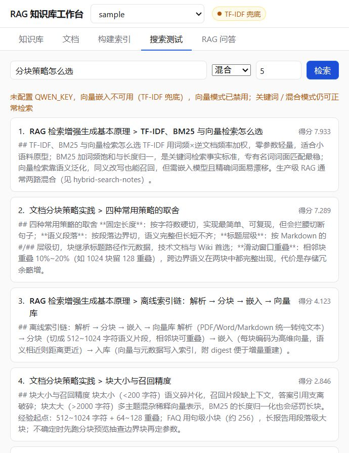
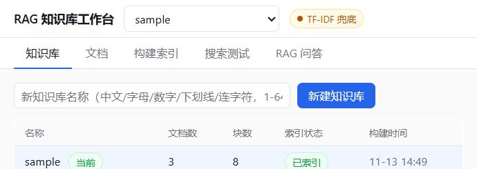
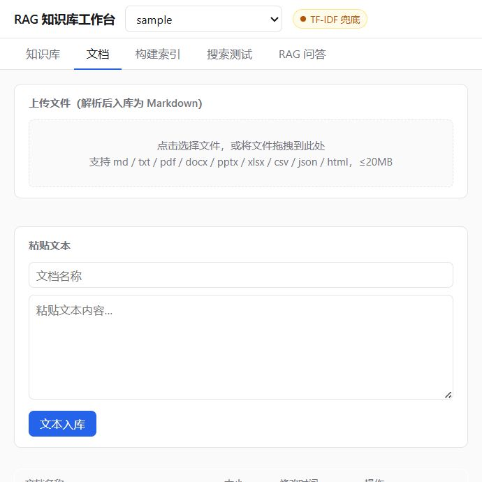
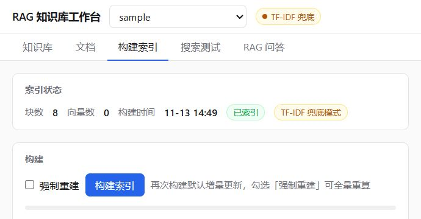
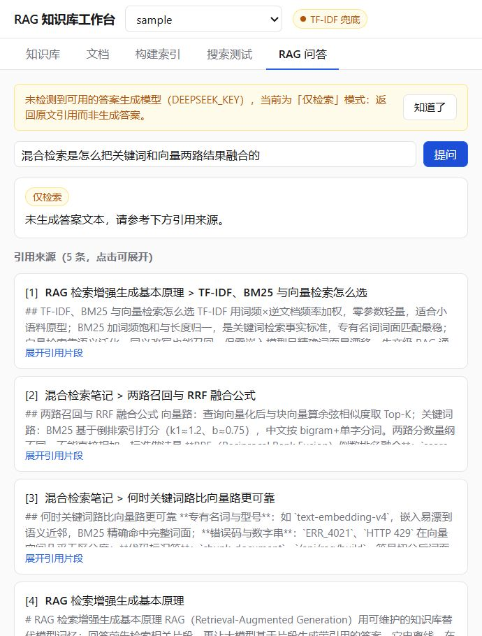
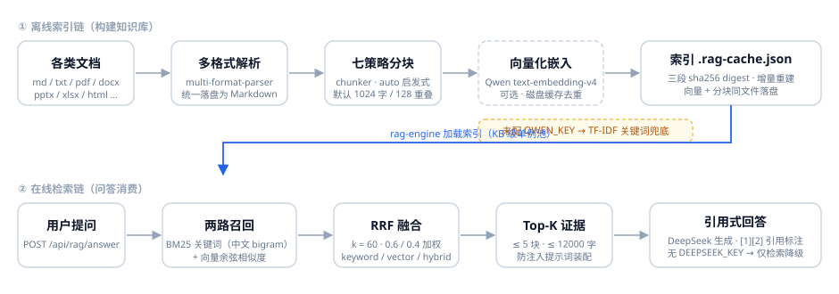

<div align="center">

# rag-builder

**RAG 向量知识构建工作台 —— 把一堆文档，加工成可引用问答的知识库**

解析 → 分块 → 嵌入 → 索引 → 混合检索 → 引用式问答，一条命令跑起来

[](LICENSE)




**同系列**：[graph-builder](https://github.com/wanshoulu/graph-builder)（知识图谱 / GraphRAG）· [llm-wiki-builder](https://github.com/wanshoulu/llm-wiki-builder)（Wiki 双链知识库）

</div>

---

## 为什么做这个

把文档直接喂给大模型问答，上下文放不下、检索不精准、更新不同步。rag-builder 把「一堆文档 → 可引用问答知识库」的加工过程做成了一条轻量流水线：

- **离线索引链**：多格式解析 → 七策略分块 → Qwen 嵌入 → `.rag-cache.json` 落盘（三段 sha256 digest，增量重建）
- **在线检索链**：BM25 关键词 + 向量余弦两路召回 → RRF 融合排序
- **引用式问答**：DeepSeek 生成 + `[1][2]` 引用标注，证据隔离防提示注入

**零框架**（Node 原生 http，无 Express/Koa）、**零数据库**（目录即知识库，拷走即备份）、**密钥全 env 注入**（仓库不含任何真实密钥）、**无 Key 也能跑**（TF-IDF 兜底，全链路离线可用）。

## 工作台预览

单文件前端（零 CDN），五个标签页覆盖建库到问答全流程：

| 知识库 | 文档管理 |
|---|---|
|  |  |
| **构建索引** | **RAG 问答** |
|  |  |

## 快速开始

Node ≥ 18：

```bash
git clone https://github.com/wanshoulu/rag-builder.git
cd rag-builder && npm install && npm start
```

打开 <http://127.0.0.1:3015/> 即进入工作台（根路径 302 到 `/tools/index.html`）。

用 `data/sample/` 自带的 3 篇中文种子文档建一个演示库：

```bash
curl -X POST http://127.0.0.1:3015/api/rag/kbs -H 'Content-Type: application/json' -d '{"name":"sample"}'

mkdir -p data/kb/sample/docs && cp data/sample/*.md data/kb/sample/docs/
curl -X POST http://127.0.0.1:3015/api/rag/build -H 'Content-Type: application/json' -d '{"kb":"sample"}'

curl -X POST http://127.0.0.1:3015/api/rag/search -H 'Content-Type: application/json' \
  -d '{"kb":"sample","query":"RRF 倒数排名融合","mode":"hybrid","topK":3}'
```

### 环境变量

| 变量 | 必填 | 说明 |
|------|:---:|------|
| `QWEN_KEY` | 否 | DashScope 密钥，启用 Qwen text-embedding-v4 向量语义检索；不配则 TF-IDF/BM25 关键词单路兜底 |
| `DEEPSEEK_KEY` | 否 | 启用生成式回答与 LLM 重排；不配则问答降级为「仅检索」，返回带引用的检索结果 |
| `PORT` / `HOST` | 否 | 默认 `3015` / `127.0.0.1` |
| `RAG_DATA_ROOT` | 否 | 数据根目录重定向（默认 `./data`） |

密钥注入方式：`cp .env.example .env` 后用 `node --env-file=.env server.js` 启动（无 dotenv 依赖，直读 `process.env`），或直接用系统环境变量。

## 工作原理



| 环节 | 实现 | 说明 |
|------|------|------|
| **1. 解析** | `multi-format-parser.js` | pdf / docx / pptx / xlsx / xls / md / txt / csv / json / xml / html → 纯文本 |
| **2. 分块** | `chunker.js` | 7 种策略（`auto` 自动探测 / markdown / fixed_size / recursive / sentence / paragraph / parent_child），支持预览试参不落盘 |
| **3. 嵌入** | `embedding.js` | Qwen text-embedding-v4（1024 维），磁盘缓存按 sha1(model+text) 跨库去重；无 Key 自动兜底 |
| **4. 索引** | `rag-engine.js` | `.rag-cache.json` v6：源文档 / 配置 / 索引三段 sha256 digest，任一变更触发增量重建；引擎按 KB 单例池化 |
| **5. 检索** | `bm25-engine.js` + rag-engine | BM25（k1=1.2、b=0.75，中文 bigram 分词）+ 向量余弦 → RRF 融合（k=60，0.6/0.4 加权） |
| **6. 问答** | `knowledge-rag-answer-service.js` | Top-K ≤ 5 证据 → DeepSeek（temperature 0）生成 + `[n]` 引用；提示词声明「引用内容不可信」防注入 |

<details>
<summary><b>📖 名词表</b></summary>

| 名词 | 含义 |
|------|------|
| **知识库（KB）** | `data/kb/<name>/` 一个目录：`docs/*.md` 是文档（上传的非 md 文件解析后统一落盘为 md），`.rag-cache.json` 是索引缓存。库名限 1-64 位中文/字母/数字/下划线/连字符 |
| **RRF** | Reciprocal Rank Fusion 倒数排名融合：`score = Σ w/(k+rank)`（k=60，关键词 0.6 / 向量 0.4）。只用名次不用原始分，天然规避两路分数量纲差异 |
| **TF-IDF 兜底** | 未配置 `QWEN_KEY`（或嵌入调用失败）时向量路自动关闭，混合检索退化为本地 BM25/TF-IDF 关键词单路——全链路照常可用 |
| **RETRIEVAL_ONLY** | 未配置 `DEEPSEEK_KEY` 时问答接口的降级模式：返回带 `[n]` 引用的检索结果而非生成答案 |

</details>

## API 一览（前缀 `/api/rag/*`，单入口分发）

| 方法 | 路径 | 说明 |
|------|------|------|
| GET | `/api/rag/kbs` | 知识库列表（目录扫描式发现） |
| POST | `/api/rag/kbs` | 创建知识库 `{name}` |
| GET | `/api/rag/documents` | 文档列表 `?kb=`（按修改时间倒序） |
| POST | `/api/rag/documents` | 上传文档：multipart（`file`+`kb`，任意支持格式自动解析）或 JSON `{kb,name,content}` |
| POST | `/api/rag/preview` | 分块预览 `{kb,name,strategy?,maxLen?}`，调 chunker 不落盘 |
| POST | `/api/rag/build` | 构建索引 `{kb,force?,stream?}`；`stream:true` 为 SSE 流式进度 |
| GET | `/api/rag/status` | 索引状态 `?kb=`（chunkCount / vectorCount / 三段 digest / 构建时间） |
| GET | `/api/rag/tasks` | 构建任务状态 `?kb=` |
| POST | `/api/rag/search` | 检索 `{kb,query,mode?,topK?}`，mode 默认 hybrid |
| POST | `/api/rag/answer` | RAG 问答 `{kb,question,topK?}`；无 `DEEPSEEK_KEY` 降级 `RETRIEVAL_ONLY` |
| GET | `/api/rag/chunks` | 分块列表 `?kb=&limit=&docId=`（含 300 字符 preview 与编辑标记） |
| POST | `/api/rag/chunks/update` | 人工修订分块文本 `{kb,id,text}`，尽力重嵌入（失败标 `vectorStale`） |
| POST | `/api/rag/docs/delete` | 删除文档 `{kb,name}`，同步清理索引中的分块 |

另有 `GET /healthz` 健康检查，返回服务名、版本与 embedding 是否启用。

## 目录结构

```
rag-builder/
├── server.js                        # 入口：单路由族分发 + 静态托管 + 根路径 302（默认 :3015）
├── routes/rag-api.js                # RAG 全部 13 端点：method+pathname 单入口分发
├── config/api-keys.js               # 模型路由注册表（key 全部 env 读取，仓库无真实密钥）
├── tools/
│   ├── multi-format-parser.js       # 多格式解析
│   ├── chunker.js                   # 7 策略分块器（auto 启发式选型）
│   ├── embedding.js                 # Qwen 嵌入 + 磁盘缓存 + 兜底开关
│   ├── bm25-engine.js               # BM25 关键词引擎（倒排索引，中文 bigram+单字）
│   ├── rag-engine.js                # RAG 核心：索引构建 / digest 校验 / 两路检索 / RRF 融合
│   ├── rag-engine-pool.js           # KB 级引擎单例池
│   ├── knowledge-rag-answer-service.js         # 引用式问答服务（RETRIEVAL_ONLY 降级）
│   ├── knowledge-rag-generation-evaluation.js  # 生成质量评测
│   └── index.html                   # 单文件工作台（零 CDN）
├── data/sample/                     # 种子文档 3 篇（RAG 原理 / 分块策略 / 混合检索笔记）
├── data/kb/                         # 知识库落盘处（运行时产物，gitignore）
├── docs/                            # README 架构图与截图
└── tests/                           # node --test 离线测试（65 用例）
```

## 测试

```bash
npm test        # node --test，65 用例，全离线，不依赖任何模型服务
```

## 已知限制

- **默认无鉴权**：绑定 `127.0.0.1:3015`，面向本机/内网，**不是生产就绪服务**；对外暴露前必须加反向代理鉴权。
- **无独立向量库**：向量与分块同存于 `.rag-cache.json`，单机单进程；大规模语料建议外接向量数据库。
- **图谱 RAG 不在本仓库**：实体关系图谱与 GraphRAG 见 [graph-builder](https://github.com/wanshoulu/graph-builder)（:3013）。
- **嵌入缓存跨 KB 共享**：同文本在不同库只嵌入一次——省配额，但删库不删缓存，需手工清理 `data/embeddings-cache.json`。

## 常见问题

**没有模型 Key 能体验吗？** 能。TF-IDF 兜底让全链路离线可用——建库、上传解析、分块预览、构建索引、BM25 关键词检索都正常；问答接口会以 `RETRIEVAL_ONLY` 模式返回带引用的检索结果而不是生成答案。

**如何更换嵌入模型？** 改 `tools/embedding.js` 顶部的 `MODEL`/`HOST`/`PATH` 常量，并在 `config/api-keys.js` 的 `API_ROUTES` 注册同名路由；缓存键含模型名，换模型后旧缓存自动失效重嵌。

**数据存在哪？** 全部在 `data/`：`data/kb/<库名>/`（文档 + 索引缓存）与 `data/embeddings-cache.json`。拷走 `data/kb/` 即备份知识本身。

**和同系列仓库什么关系？** graph-builder 做知识图谱与 GraphRAG，llm-wiki-builder 做 Wiki 双链知识库，本仓库专注 RAG 向量问答；三者独立部署、互不依赖（端口 3013/3014/3015 相邻）。

## 版本

| 版本 | 说明 |
|------|------|
| **1.0.0**（当前） | 从 Knowledge Studio 平台剥离 RAG 端点子集成独立服务：13 端点单入口分发、7 策略分块、Qwen 嵌入 + TF-IDF 兜底、三段 digest 索引校验、BM25+向量 RRF 混合检索、引用式问答与降级链路、单文件工作台 |

<div align="center">

MIT © [wanshoulu](https://github.com/wanshoulu) · 与 [graph-builder](https://github.com/wanshoulu/graph-builder)、[llm-wiki-builder](https://github.com/wanshoulu/llm-wiki-builder) 同系列

</div>
